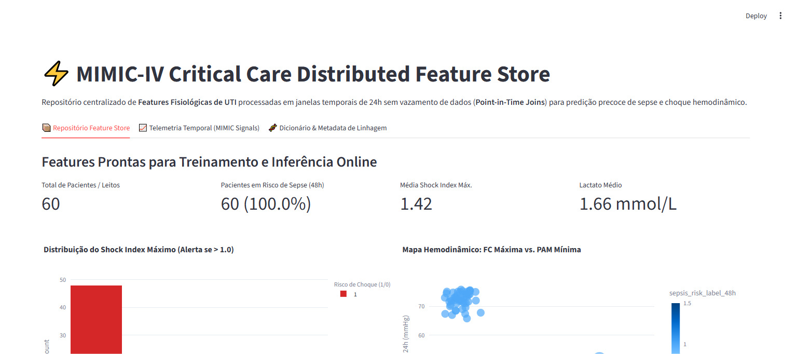

# ⚡ MIMIC-IV Critical Care Distributed Feature Store

[](https://www.python.org/downloads/)
[](#)
[](#)
[](#)
[](#)
[](#)

Repositório central de engenharia de features (**Feature Store**) inspirado na taxonomia do **MIMIC-IV** para monitoramento contínuo em terapia intensiva (UTI), extraindo métricas agregadas em janelas temporais de 24h sem vazamento de dados (**Point-in-Time Joins**) para predição precoce de choque e sepse.

---

## 📸 Validação Visual de Execução (Playwright E2E)

### Repositório Central de Features de UTI & Indicadores Hemodinâmicos


---

## 🎯 Por que uma Feature Store Centralizada em Terapia Intensiva?

Modelos preditivos que atuam em beira de leito sofrem frequentemente de:
1. **Train-Serve Skew**: As variáveis de treino foram calculadas com agregações diferentes daquelas disponíveis no momento da inferência em tempo real.
2. **Data Leakage (Vazamento Temporal)**: Utilização de dados futuros (ex: lactato coletado após o choque ter iniciado).
3. **Inconsistência de Definições**: Diferentes times de ciência de dados calculando *Shock Index* ou pressões médias com fórmulas divergentes.

Esta Feature Store garante:
- **Janelas Móveis Padronizadas**: Agregações horárias (médias, picos e vales) das primeiras 24h de internação.
- **Join Point-in-Time**: Garantia matemática de que medições laboratoriais só alimentam a feature se seu timestamp for estritamente anterior ao evento de corte.
- **Pronta para Inferência Online**: Disponibilização síncrona para modelos de alerta precoce de deterioração clínica.

---

## 🏛️ Estrutura Arquitetural (CRISP-DM + SDD)

```
spark-feature-store-mimic/
├── SPEC.md                           # Contratos Pydantic formais de entrada/saída
├── crisp_dm/
│   └── 02_data_understanding.md      # Princípios de dados e integridade temporal MIMIC
├── src/
│   ├── schemas.py                    # Schemas Pydantic validados
│   ├── feature_store_engine.py       # Motor de extração temporal e joins point-in-time
│   └── app.py                        # Interface da Feature Store e séries temporais
├── tests/
│   └── unit/
│       └── test_feature_store.py     # Testes de integridade com PyTest
├── docs/
│   └── screenshots/                  # Evidências Playwright E2E
├── Dockerfile                        # Conteinerização pronta para produção
└── requirements.txt                  # Dependências fixadas
```

---

## 🧪 Variáveis Fisiológicas Calculadas

| Nome da Feature | Janela Temporal | Expressão / Conceito Clínico | Finalidade Preditiva |
| :--- | :--- | :--- | :--- |
| **`shock_index_max`** | 24 horas | $\max \left( \frac{\text{Heart Rate}}{\text{Mean Arterial Pressure}} \right)$ | Indicador sensível de hipoperfusão tecidual precoce ($> 0.9$) |
| **`map_min_24h`** | 24 horas | $\min(\text{MAP})$ em mmHg | Identificação de episódios hipotensivos graves |
| **`hr_max_24h`** | 24 horas | $\max(\text{FC})$ em bpm | Resposta inflamatória sistêmica (SIRS / Taquicardia) |
| **`lactate_last_known`** | Point-in-Time | Último lactato arterial disponível | Marcador de acidose lática e gravidade metabólica |

---

## 🚀 Como Executar Localmente

### 1. Clonar o repositório
```bash
git clone https://github.com/generozo-paulo/spark-feature-store-mimic.git
cd spark-feature-store-mimic
```

### 2. Instalar dependências
```bash
pip install -r requirements.txt
```

### 3. Rodar suíte de testes unitários
```bash
python -m pytest tests/unit/ -v
```

### 4. Iniciar Interface da Feature Store
```bash
python -m streamlit run src/app.py
```
Acesse em: `http://localhost:8501`

---

## 🐳 Execução via Docker

```bash
docker build -t spark-feature-store-mimic .
docker run -p 8501:8501 spark-feature-store-mimic
```

---

## 👨‍💻 Autor

**Paulo Generozo**
- GitHub: [@generozo-paulo](https://github.com/generozo-paulo)
- Especialização: Feature Stores, Big Data & Critical Care Data Science
